# Mini Blockchain Network

a bitcoin-inspired blockchain network , built from scratch in python

every node is its own program with its own copy of the chain , they find each other , send transactions , mine blocks , and vote on which block gets accepted , all over HTTP

> this started as a university assignment , the stack and the architecture were my choice : python + fastapi for the backend , electronjs for the GUI
>
> the source code is not in this repo , i am happy to walk through the code and the design on a call

  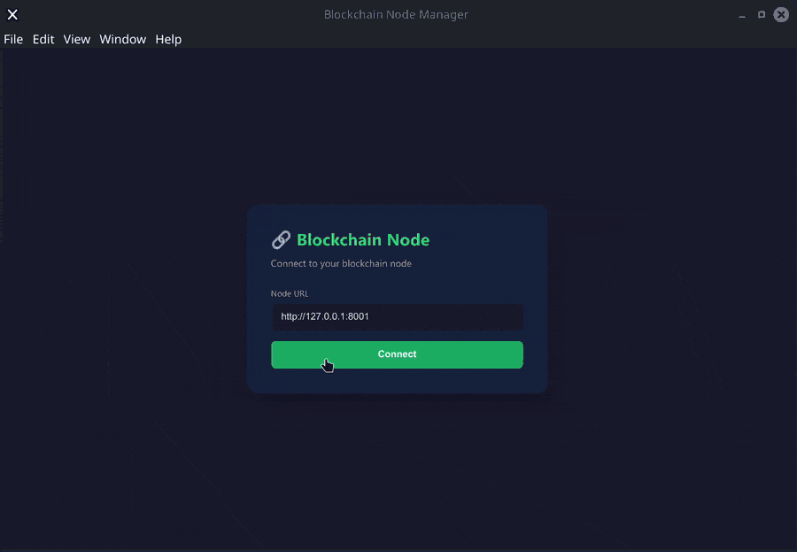

<a href="#the-network-in-action">see the full run, node by node ↓</a>

## Idea

the assignment was to build a small blockchain : transactions , blocks , mining , and nodes that agree on the chain

i didn't want one script that fakes a network , i wanted a real one . so every node is a separate process with its own port , and they only talk to each other through HTTP requests , like real peers would

## what it does

- __transactions__ : one sender can pay several receivers in a single transaction
- __blocks__ : SHA-256 hashing , a merkle root of the transactions , and proof of work (difficulty 3)
- __balances__ : computed from the chain itself , no separate database
- __joining the network__ : a new node syncs the chain from the coinbase node , registers , discovers the other peers , and asks the faucet for 100 coins . it then mines that faucet transaction itself and earns the 50 block reward , so it starts with __150 coins__
- __peer discovery__ : when a node joins , everyone already in the network is notified , and every node refreshes its peer list every 30 seconds
- __transaction checks__ : every node checks the amount is positive , that the sender has enough funds , and that it is not a duplicate , before it goes into its mempool
- __mining + voting__ : the miner finds the nonce , the peers vote , and the block is committed only if the majority agrees (more below)
- __mining in the background__ : the proof of work runs in a separate thread , so the node's API stays responsive while it mines
- __3 ways to use a node__ : a REST API , a terminal REPL , and an Electron GUI

## the architecture

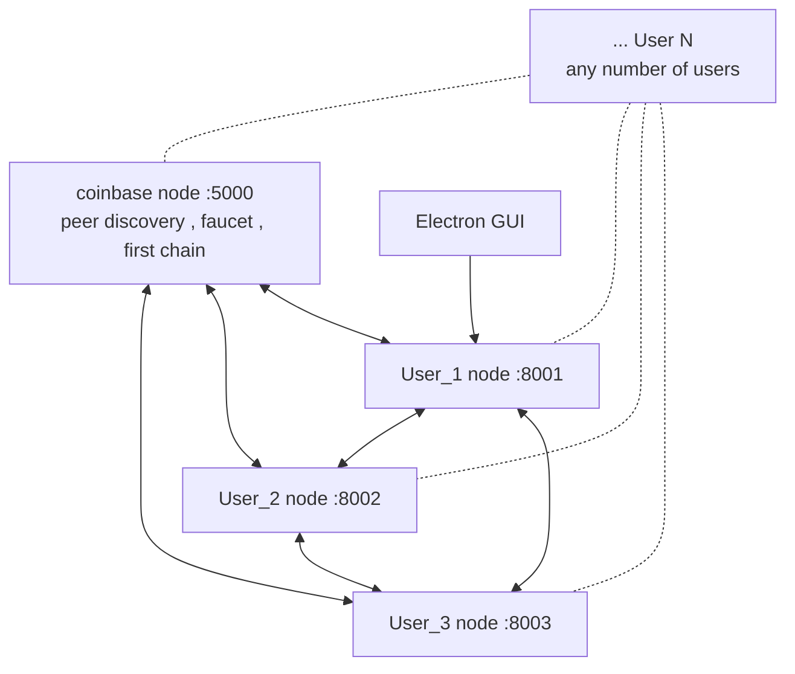

the network is not limited to 3 users , the diagram is just an example . any number of user nodes can join , each one with its own name and port

- __the coinbase node__ creates the genesis block and mines the first blocks . it is also the entry point : new nodes register with it and get the list of the other peers
- __the user node__ is the backend that runs on each user's side , same logic , its own port , its own chain . the Electron GUI sits on top of it
- after joining , nodes talk to __each other directly__ , transactions , votes and new blocks do not go through a central server

## how a block gets accepted

1. the miner takes the pending transactions , adds its reward transaction , and searches for a valid nonce (proof of work)
2. it sends the block to every peer and asks them to validate it
3. each peer checks that the block links to the end of its own chain . if two blocks compete for the same spot , the one with the __earliest timestamp wins__
4. if more than half of the network votes yes , the miner announces the winner , everyone commits the block and removes its transactions from their mempool

this is how i deal with two miners finding a block at the same time . it is a simpler rule than bitcoin's longest chain , but it is easy to follow and to test

## under the hood

the architecture diagram shows who talks to whom. these three show **what they say to each other**: every arrow is a real HTTP call between two separate processes.

### joining the network

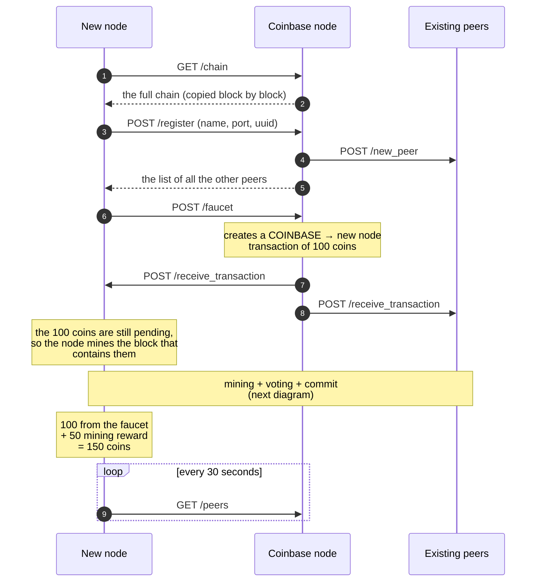

a new node starts with **150 coins**: the faucet sends 100, but that transaction is only pending until a block contains it. the new node mines that block itself and collects the 50-coin reward. (the faucet coins are newly created, not taken from anyone's balance. the coinbase node's own mining reward is 1000, a normal user's is 50.)

### from a transaction to a committed block

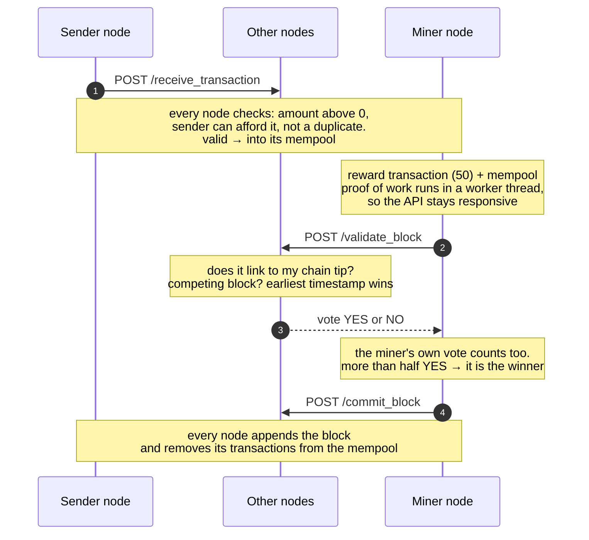

### how a peer decides its vote

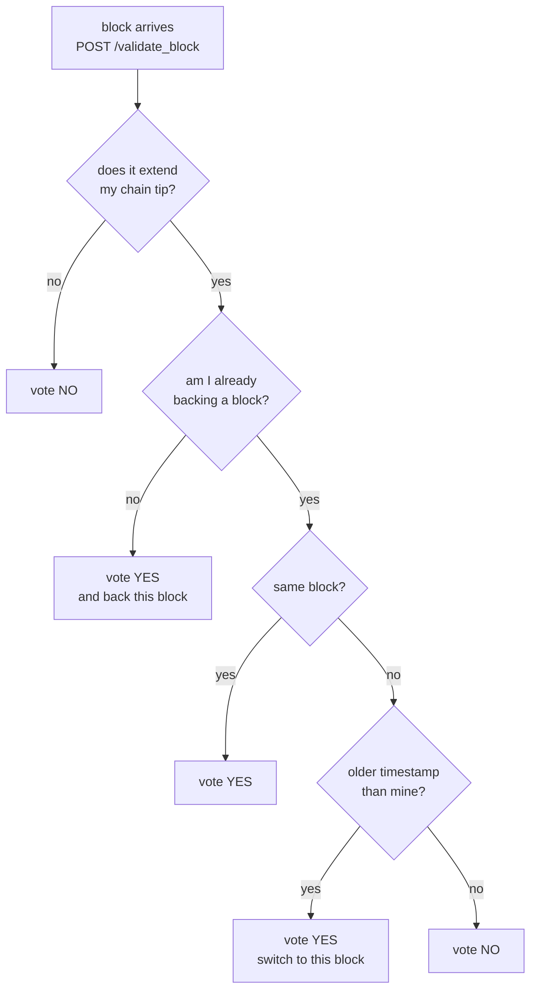

this is the rule that handles two miners finding a block at the same time. with 4 nodes (the coinbase node + 3 users), a block needs 3 YES votes to win.

## Stack

`python`

`fastapi` + `uvicorn` - node servers

`httpx` - async calls between nodes

`hashlib` - SHA-256

`electronjs` - GUI

## what this project shows

- designing a protocol between independent processes (discovery , broadcast , voting , commit)
- async python and a REST API with fastapi
- hashing , merkle trees and proof of work , implemented by hand
- a desktop GUI on top of a local backend

## what it is and what it is not

i prefer to be clear about this :

- there are __no digital signatures__ yet , a node's name is its address , so this is a learning network and not a secure one
- the difficulty is fixed (3) , there is no difficulty adjustment and no halving
- peers vote on the block's link and timestamp , they do not re-check the proof of work themselves
- all the nodes run on `localhost` on different ports
- the coinbase node is needed to __join__ (discovery , first sync , faucet) , after that nodes talk to each other
- a node syncs the full chain when it starts , a node that went offline has to be restarted to catch up

## the network in action --Pictures--

everything below is real output from real runs. each terminal is one node: its own process, its own port, its own copy of the chain. *click any image to zoom in.*

---

### 1 · starting the coinbase node

the coinbase node comes up first: it creates the genesis block, mines the first blocks, and starts waiting for peers.

  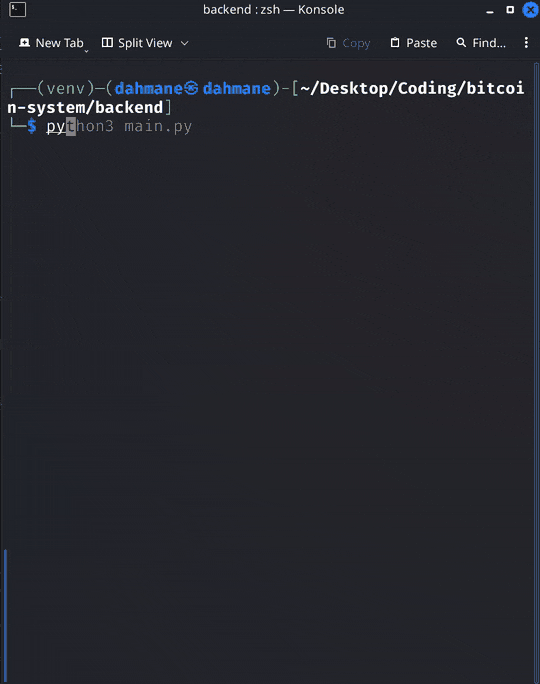
   
  <b>the coinbase node booting and mining its first blocks</b>

<table>
  <tr>
    <td width="50%" valign="top">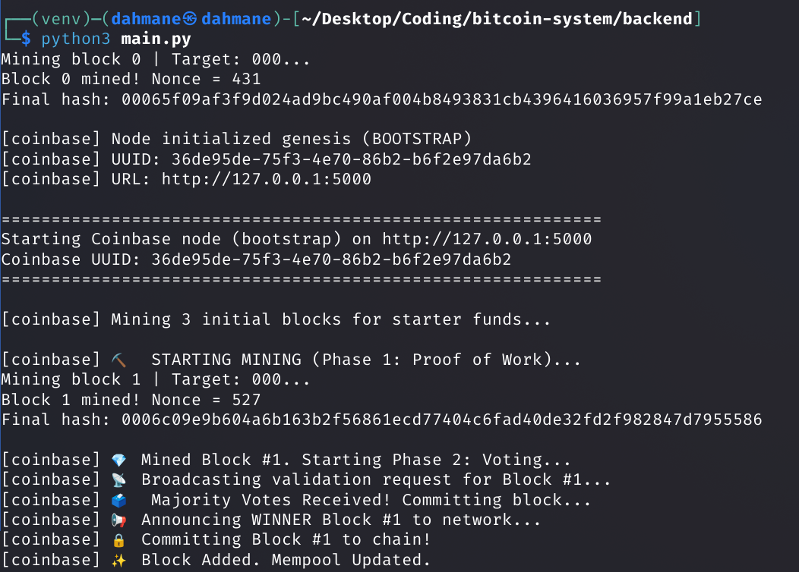</td>
    <td width="50%" valign="top">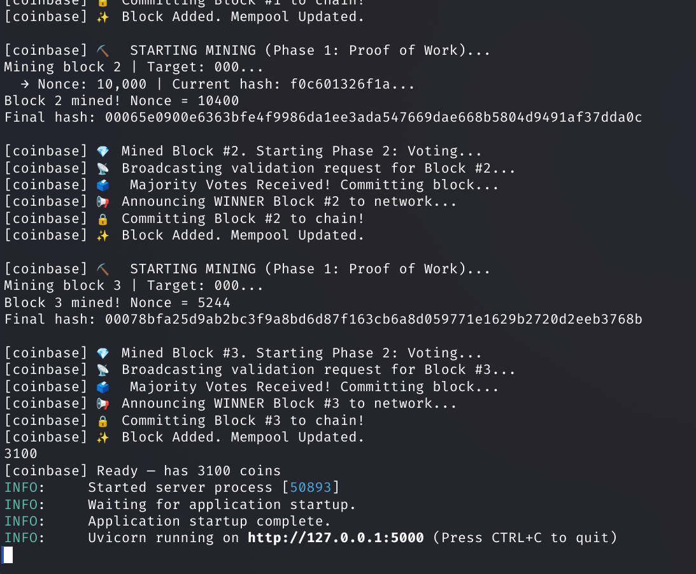</td>
  </tr>
  <tr>
    <td align="center">startup, part 1</td>
    <td align="center">startup, part 2</td>
  </tr>
</table>

---

### 2 · three users join the network

each user node syncs the chain from the coinbase node, registers, discovers the other peers, and asks the faucet for its 100 starting coins.
every new node ends up with **150 coins**: 100 from the faucet + 50 for mining the block that contains it.

  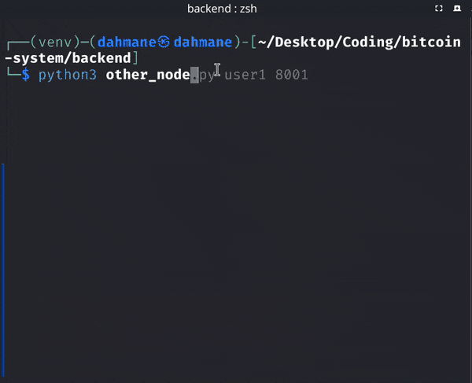
   
  <b>user 1 joining the network</b>

<table>
  <tr>
    <td width="50%" valign="top">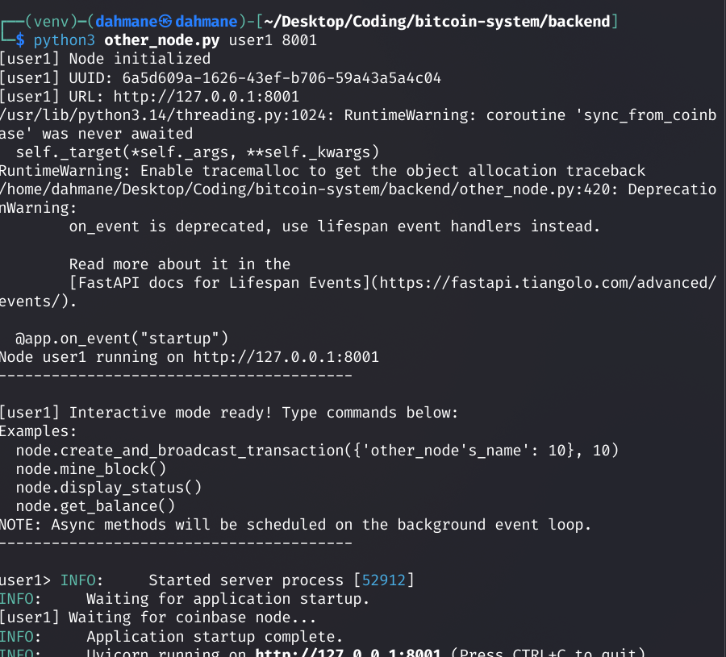</td>
    <td width="50%" valign="top">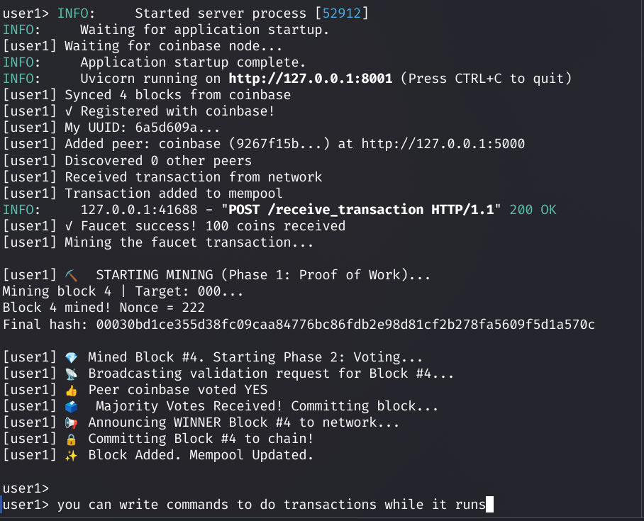</td>
  </tr>
  <tr>
    <td align="center">user 1, part 1</td>
    <td align="center">user 1, part 2</td>
  </tr>
</table>

users 2 and 3 do exactly the same thing (only the important lines are shown here):

<table>
  <tr>
    <td width="50%" valign="top">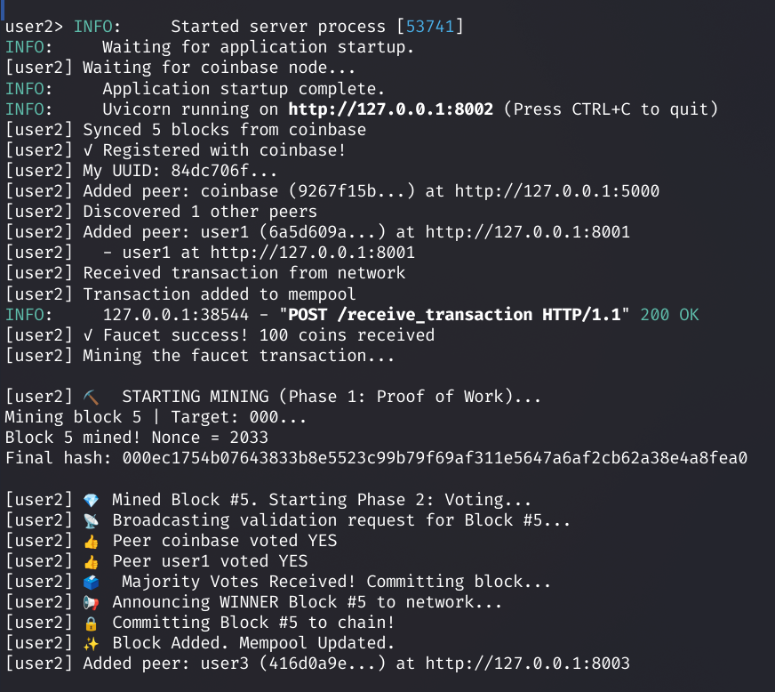</td>
    <td width="50%" valign="top">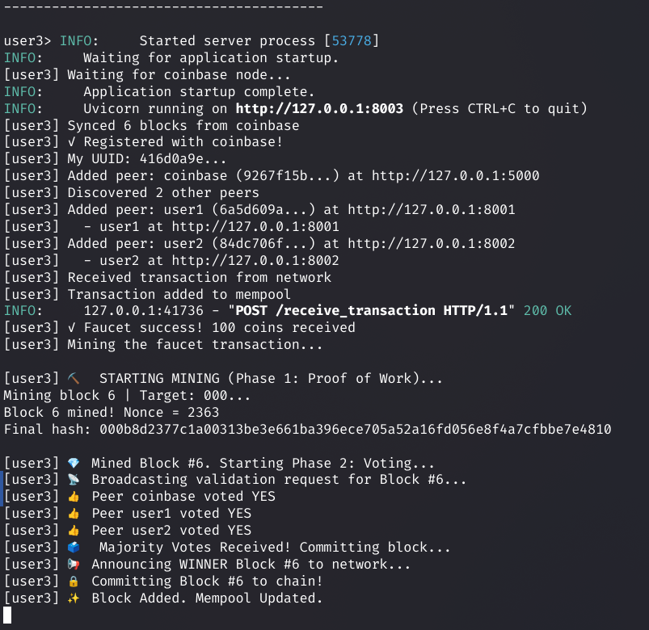</td>
  </tr>
  <tr>
    <td align="center">user 2 joins</td>
    <td align="center">user 3 joins</td>
  </tr>
</table>

and this is the same moment seen from the other side, the coinbase node while user 1 was joining:

  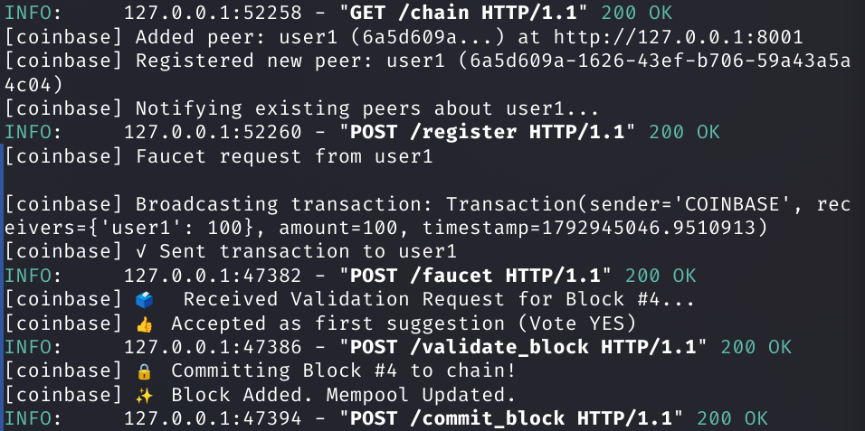
   
  <b>the coinbase node registering user 1 and answering its requests</b>

---

### 3 · user3 sends coins to user 1

user 3 uses the node from the shell and makes a transaction. it is valid and broadcast, but **not mined yet**, so it sits in the mempool of the other nodes.

  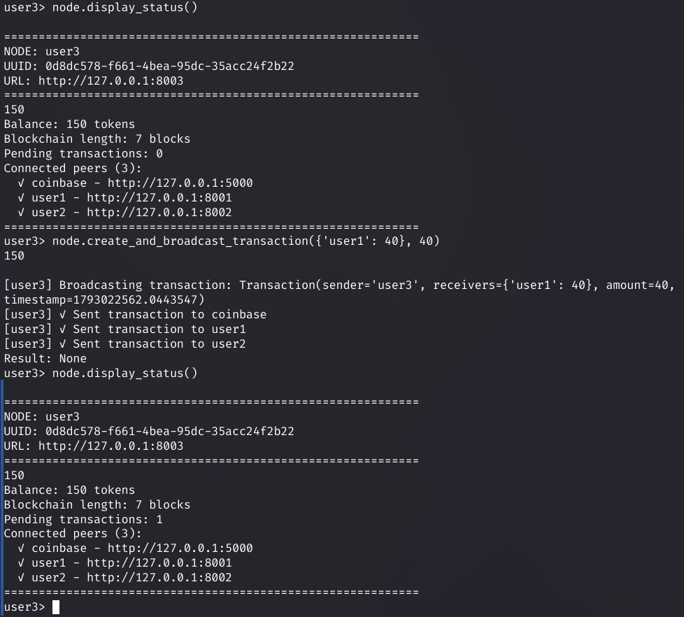
   
  <b>user 3 creates the transaction from the shell</b>

<table>
  <tr>
    <td width="50%" valign="top">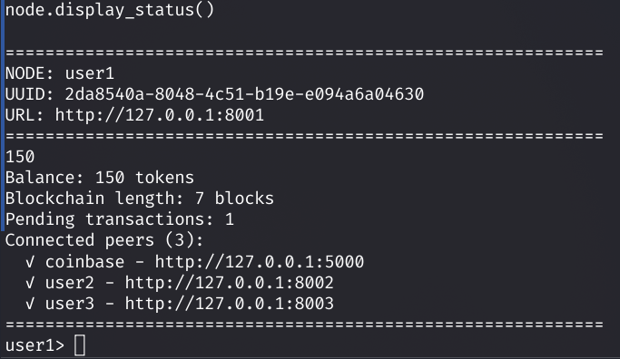</td>
    <td width="50%" valign="top">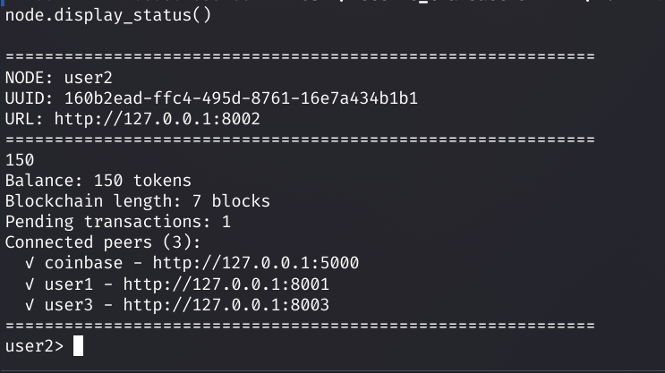</td>
  </tr>
  <tr>
    <td align="center">user 1 : status after the transaction</td>
    <td align="center">user 2 : status after the transaction</td>
  </tr>
</table>

---

### 4 · user 2 mines the block

user 2 takes the pending transaction, adds its reward, and runs the proof of work. then the peers vote, and the block is committed only if the majority agrees.

  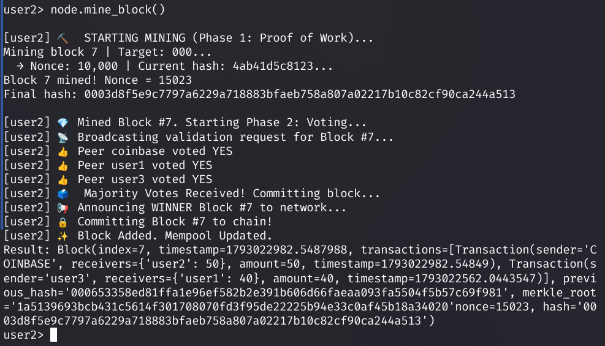
   
  <b>user 2 mining the block (proof of work, then the vote)</b>

  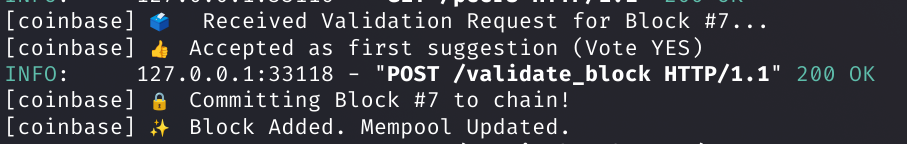
   
  <b>the coinbase node during that mining : validating the block and voting</b>

after the commit, every node ends up with the same chain. first the miner, then the two peers:
- it went from 150 coins to 200 because it gets 50 for mining 

  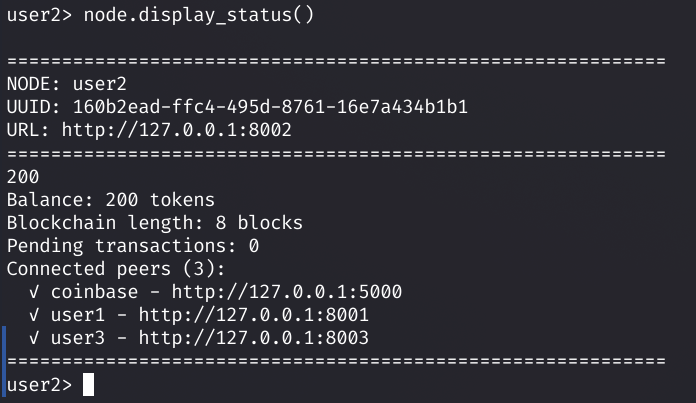
   
  <b>user 2 (the miner) : status after mining</b>

<table>
  <tr>
    <td width="50%" valign="top">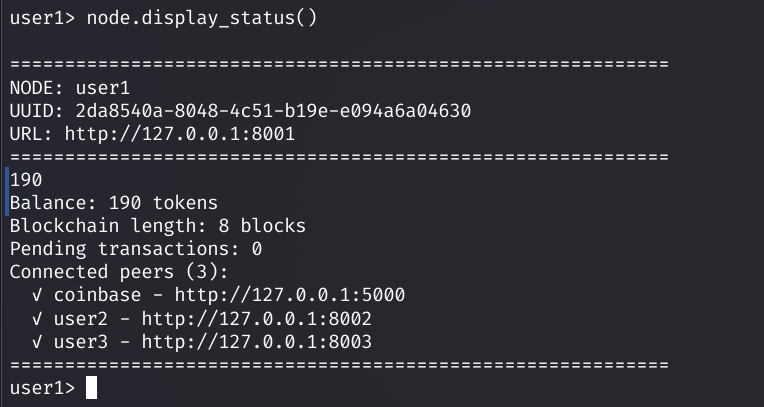</td>
    <td width="50%" valign="top">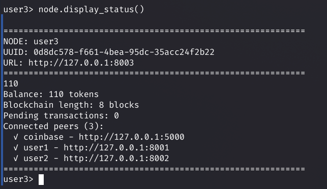</td>
  </tr>
  <tr>
    <td align="center">user 1 : status after the block</td>
    <td align="center">user 3 : status after the block</td>
  </tr>
</table>

---

### 5 · the same thing, through the GUI

everything above can be done from the shell, and the Electron GUI on top of a node does all of it, and more.

  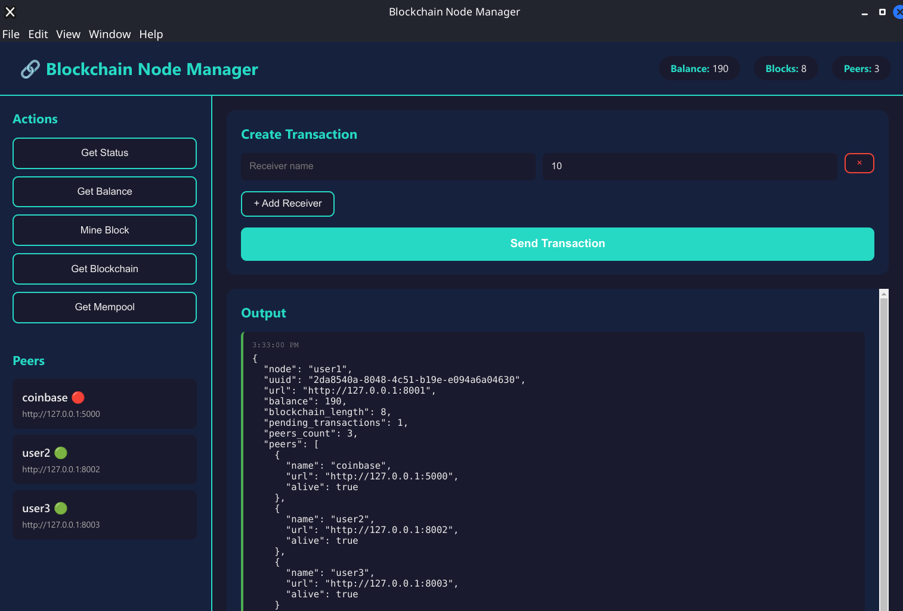
   
  <b>the GUI : one node, one window</b>

  
   
  <b>using the GUI</b>

