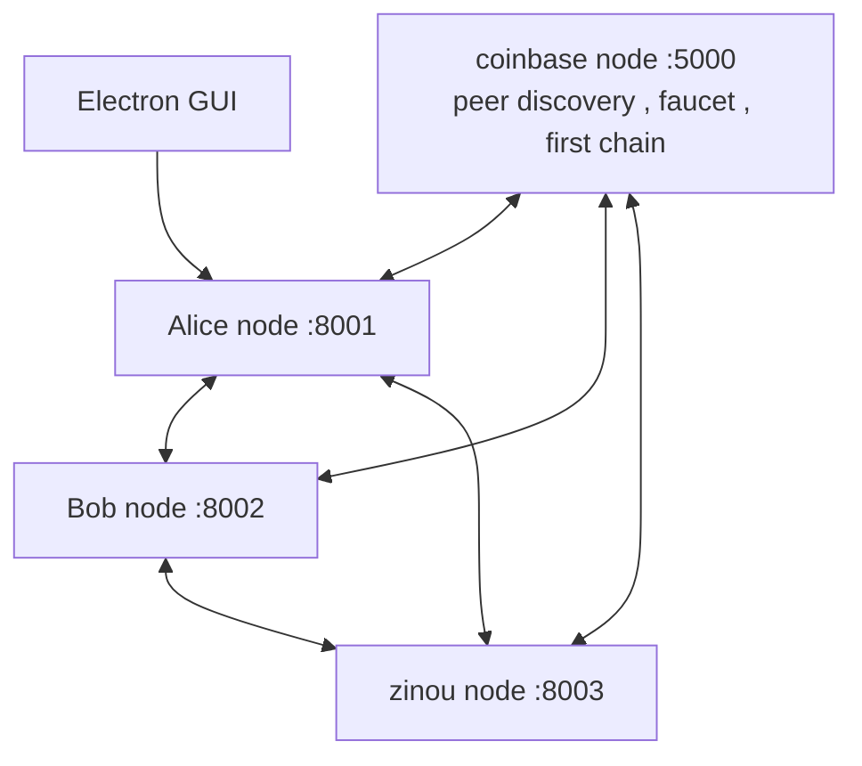

# Mini Blockchain Network

a bitcoin-inspired blockchain network , built from scratch in python

every node is its own program with its own copy of the chain , they find each other , send transactions , mine blocks , and vote on which block gets accepted , all over HTTP

> this started as a university assignment , the stack and the architecture were my choice : python + fastapi for the backend , electronjs for the GUI


## Idea

the assignment was to build a small blockchain : transactions , blocks , mining , and nodes that agree on the chain

i didn't want one script that fakes a network , i wanted a real one . so every node is a separate process with its own port , and they only talk to each other through HTTP requests , like real peers would

## what it does

- __transactions__ : one sender can pay several receivers in a single transaction
- __blocks__ : SHA-256 hashing , a merkle root of the transactions , and proof of work (difficulty 3)
- __balances__ : computed from the chain itself , no separate database
- __joining the network__ : a new node syncs the chain from the coinbase node , registers , discovers the other peers , and asks the faucet for 100 starting coins
- __peer discovery__ : when a node joins , everyone already in the network is notified , and every node refreshes its peer list every 30 seconds
- __transaction checks__ : every node checks the amount is positive , that the sender has enough funds , and that it is not a duplicate , before it goes into its mempool
- __mining + voting__ : the miner finds the nonce , the peers vote , and the block is committed only if the majority agrees (more below)
- __mining in the background__ : the proof of work runs in a separate thread , so the node's API stays responsive while it mines
- __3 ways to use a node__ : a REST API , a terminal REPL , and an Electron GUI

## the architecture



- __the coinbase node__ (`main.py`) creates the genesis block and mines the first blocks . it is also the entry point : new nodes register with it and get the list of the other peers
- __the user node__ (`other_node.py`) is the backend that runs on each user's side , same logic , its own port , its own chain . the Electron GUI sits on top of it
- after joining , nodes talk to __each other directly__ , transactions , votes and new blocks do not go through a central server

## how a block gets accepted

1. the miner takes the pending transactions , adds its reward transaction , and searches for a valid nonce (proof of work)
2. it sends the block to every peer and asks them to validate it
3. each peer checks that the block links to the end of its own chain . if two blocks compete for the same spot , the one with the __earliest timestamp wins__
4. if more than half of the network votes yes , the miner announces the winner , everyone commits the block and removes its transactions from their mempool

this is how i deal with two miners finding a block at the same time . it is a simpler rule than bitcoin's longest chain , but it is easy to follow and to test

## Stack

`python`
`fastapi` + `uvicorn` - node servers
`httpx` - async calls between nodes
`hashlib` - SHA-256
`electronjs` - GUI

## how to run

```bash
pip install fastapi uvicorn httpx requests
```

__1.__ start the coinbase node first (it mines the first blocks , wait for it to finish)

```bash
python main.py
```

__2.__ then start user nodes , each one in its own terminal , with a __name__ and a __port__ (wait a little between them)

```bash
python other_node.py Alice 8001
python other_node.py Bob 8002
```

each new node syncs the chain , registers , gets 100 coins from the faucet , and mines the block that contains them

> [!important]
>
> the node's name is its address in the network , so every node needs a different name

__3.__ use it , from the terminal of the node :

```python
node.create_and_broadcast_transaction({'Bob': 10}, 10)   # ({receiver : amount , ...} , total)
node.mine_block()
node.display_status()
node.get_balance()
```

or with the REST API :

```bash
# send 10 coins from Alice to Bob
curl -X POST "http://127.0.0.1:8001/transaction/create?amount=10" \
     -H "Content-Type: application/json" -d '{"Bob": 10}'

# mine the pending transactions
curl -X POST http://127.0.0.1:8001/mine
```

| endpoint | what it does |
|---|---|
| `GET /status` | balance , chain length , mempool size , peers |
| `GET /balance` | balance of the node |
| `GET /chain` | the whole blockchain |
| `GET /mempool` | pending transactions |
| `POST /transaction/create` | create and broadcast a transaction |
| `POST /mine` | mine a block and ask the network to vote |

the coinbase node has the same endpoints on port `5000` , plus `GET /peers` , `POST /faucet` , and `GET /balance/{name}` to see anyone's balance

__GUI :__ TODO add the electron run command here

## what it is and what it is not

i prefer to be clear about this :

- there are __no digital signatures__ yet , a node's name is its address , so this is a learning network and not a secure one
- the difficulty is fixed (3) , there is no difficulty adjustment and no halving
- peers vote on the block's link and timestamp , they do not re-check the proof of work themselves
- all the nodes run on `localhost` on different ports
- the coinbase node is needed to __join__ (discovery , first sync , faucet) , after that nodes talk to each other
- a node syncs the full chain when it starts , a node that went offline has to be restarted to catch up

## some pictures and how it looks

#### starting the network


#### a block being mined and voted on


#### the GUI


#### the API


