# Motor Bikes — e-commerce website

> a full online shop for a mechanical parts and motorcycle seller , built for a real client with **Django** and **React** .

**Heads up , honest status:** i built this for a client i know in person . when it was deployed for the last round (testing , final touches , showing him the full work) i called him , and he had closed his business and moved to a government job . so it never went live with real customers . everything you see below is the finished app running with mock data .

`Django` · `React` · `REST API` · `Resend (emails)` · `Render` · `Netlify`

---

## What it does

A visitor opens the shop and can browse , search , add to cart and order . no account is forced on him :

- **Logged in** : the cart is saved , and he can see all his previous orders
- **Anonymous** : he can still buy , but the cart is not saved and he can't see old orders
- **Arabic and English** , with the layout flipping to right-to-left for Arabic
- **Product pages** with details and pictures , a product list , and a cart that opens as a side panel
- **Checkout** in clear steps , then an order confirmation page , and a confirmation **email** sent through Resend
- **Contact page** for questions
- **Admin side** : the owner manages the orders and opens any order to see its details
- **Responsive** : works on desktop , tablet and phone (the screenshots are real captures of each size)
- **Full control**: Complete control CRUD operations over Products and Categories for the admin.
- __3 languages__ : Arabic , French , English

## How it's deployed

| part | where |
|---|---|
| React frontend | **Netlify** |
| Django backend + database | **Render** |
| Transactional emails | **Resend** (third-party service) |

The frontend talks to the backend only through the API , so each part can be updated alone.

---

## Screenshots

*Click any image to see it bigger. The long full-page captures are at the end.*

### The main screen

  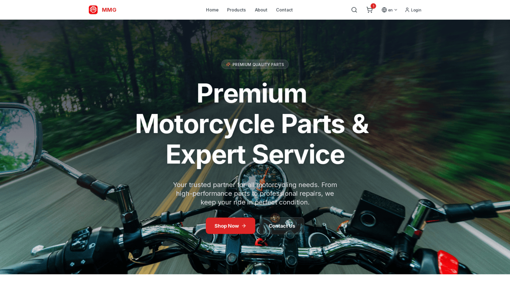

### Browsing the products

<table>
  <tr>
    <td align="center" width="33%">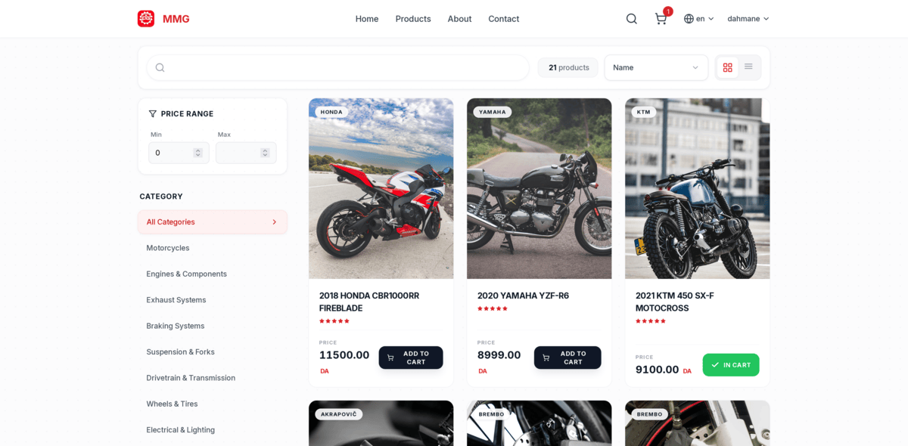 products , with an item in the cart</td>
    <td align="center" width="33%">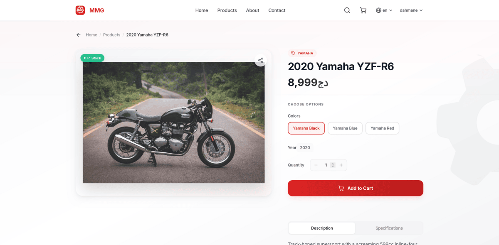 a product's details</td>
    <td align="center" width="33%">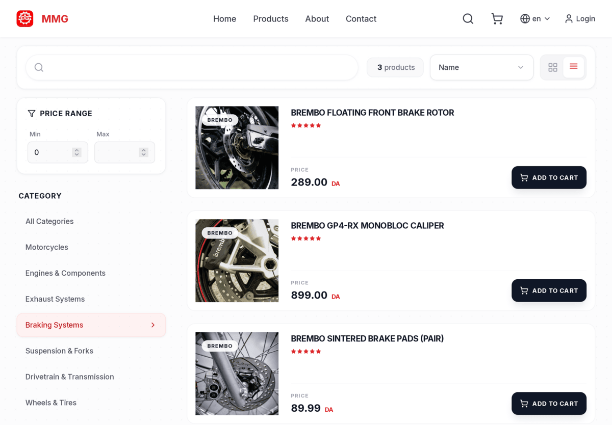 product tiles , tablet view</td>
  </tr>
</table>

### Cart

<table>
  <tr>
    <td align="center" width="50%">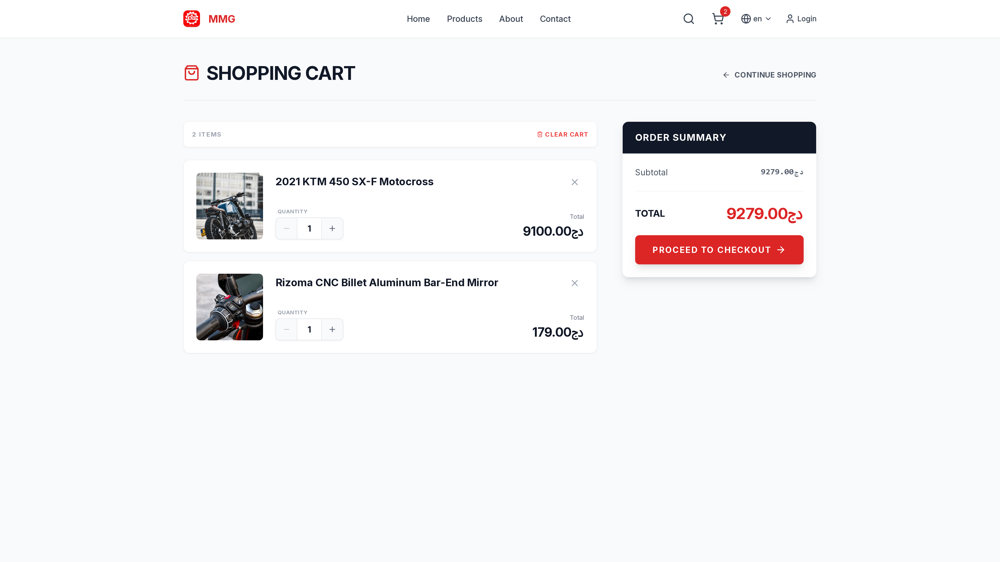 the cart page</td>
    <td align="center" width="50%">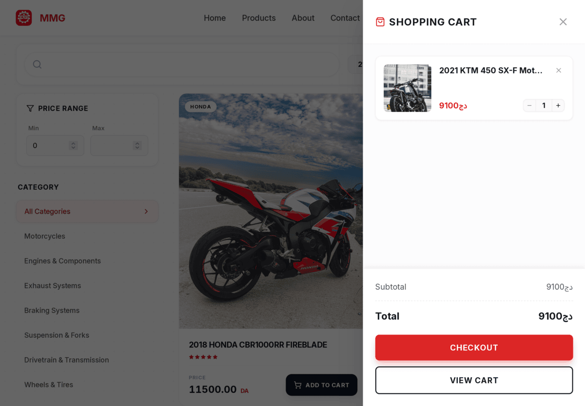 the side cart (tablet)</td>
  </tr>
</table>

### Checkout

three parts , left to right :

<table>
  <tr>
    <td align="center" width="33%" valign="top">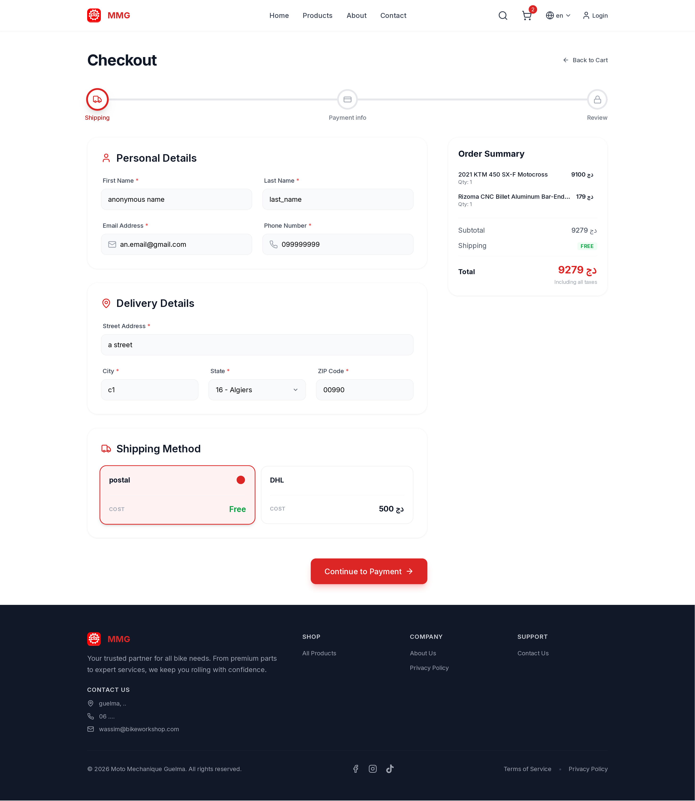 part 1 (with mock data)</td>
    <td align="center" width="33%" valign="top">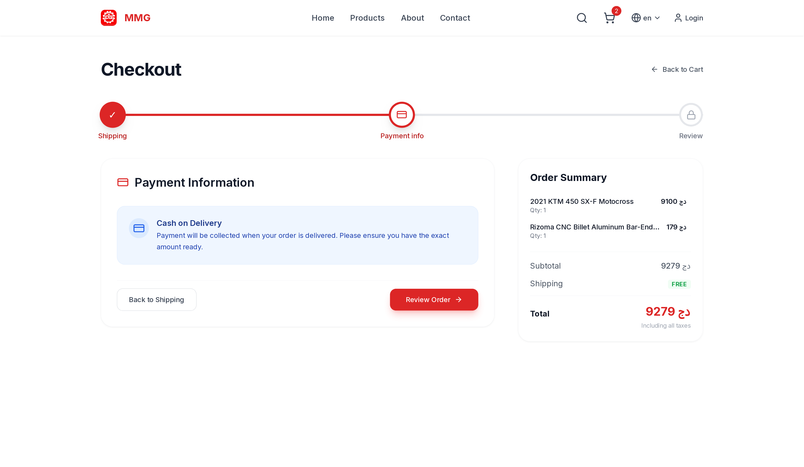 part 2</td>
    <td align="center" width="33%" valign="top">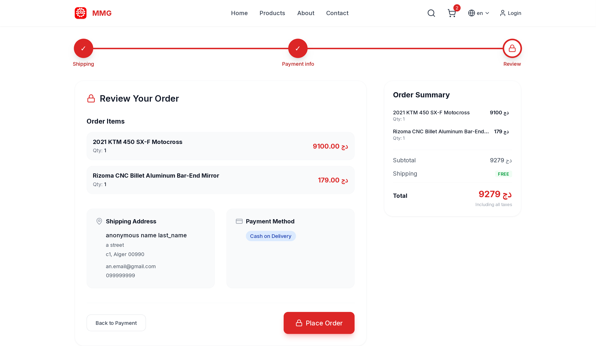 part 3</td>
  </tr>
</table>

### Orders , for the customer and for the owner

<table>
  <tr>
    <td align="center" width="33%">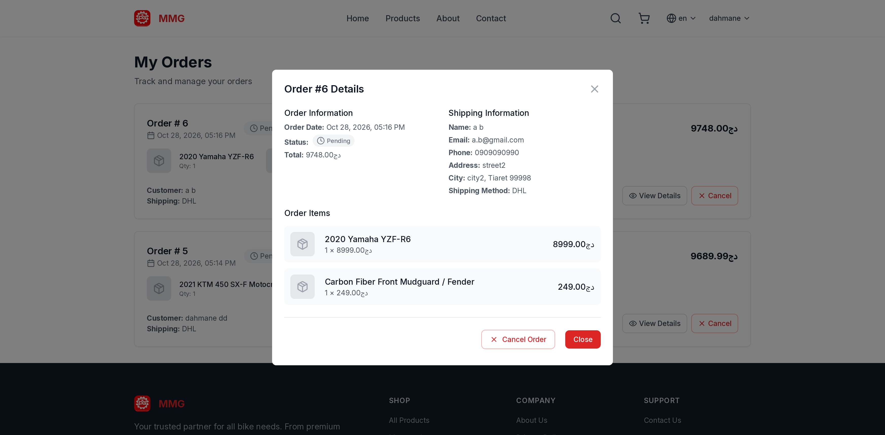 customer : my orders</td>
    <td align="center" width="33%">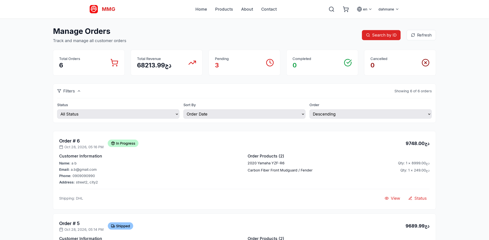 owner : manage orders</td>
    <td align="center" width="33%">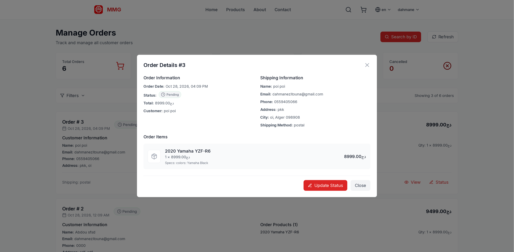 owner : one order's details</td>
  </tr>
</table>

---

## Design notes

- **Anonymous checkout on purpose** : forcing an account loses customers , so the account only adds comfort (saved cart , order history) , its not a wall .
- **Separate frontend and backend** : React on Netlify , Django on Render , connected by an API . the frontend can change without touching the server .
- **Emails are not sent from the app itself** : Resend handles delivery , so order emails dont end up in spam as often .
- **Same pages in two languages** , including right-to-left , not a translated copy of the site .

## What it is and what it is not

- built for one real client , tested with mock data , **never used by real customers**
- no live demo link , the business closed before launch
- the source code is not in this repo , i am happy to walk through it on a call

← [back to the portfolio](../README.md)

---

## Full-page screenshots

the whole pages from top to bottom , so they are long . click one to open it full size .

### Desktop

<table>
  <tr>
    <td align="center" width="25%" valign="top"><a href="assets/main-page-fullpage-EN.png">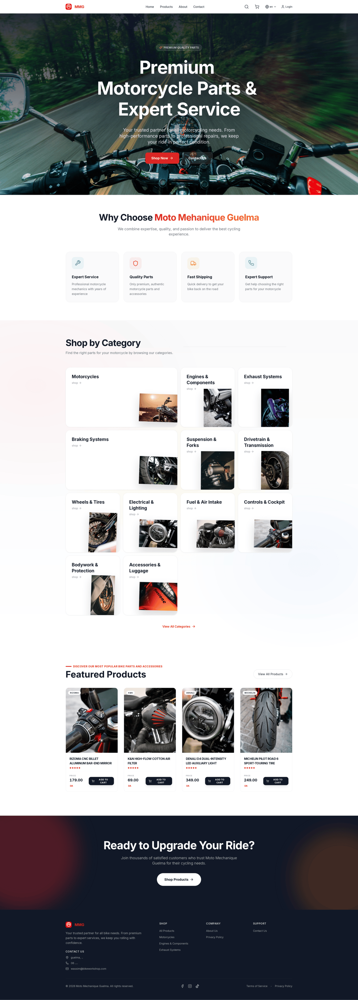</a> main page , English</td>
    <td align="center" width="25%" valign="top"><a href="assets/main-page-fullpage-AR.png">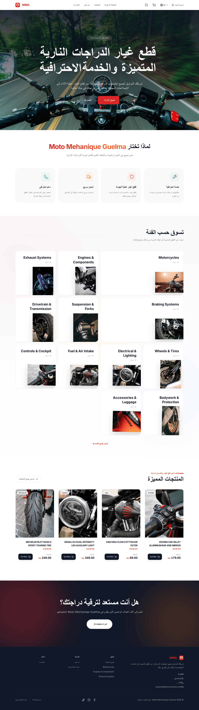</a> main page , بالعربية</td>
    <td align="center" width="25%" valign="top"><a href="assets/order-confirmed-page-fullpage.png">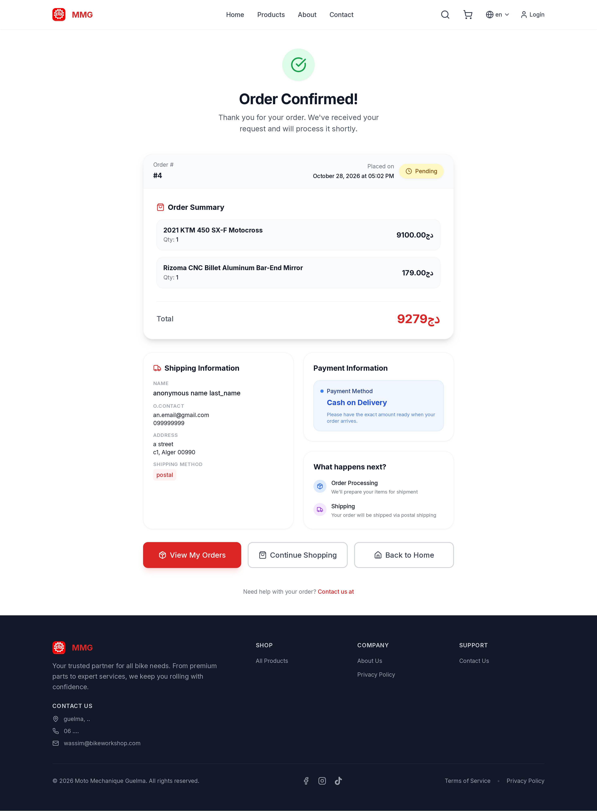</a> order confirmed</td>
    <td align="center" width="25%" valign="top"><a href="assets/contact-page-full.png">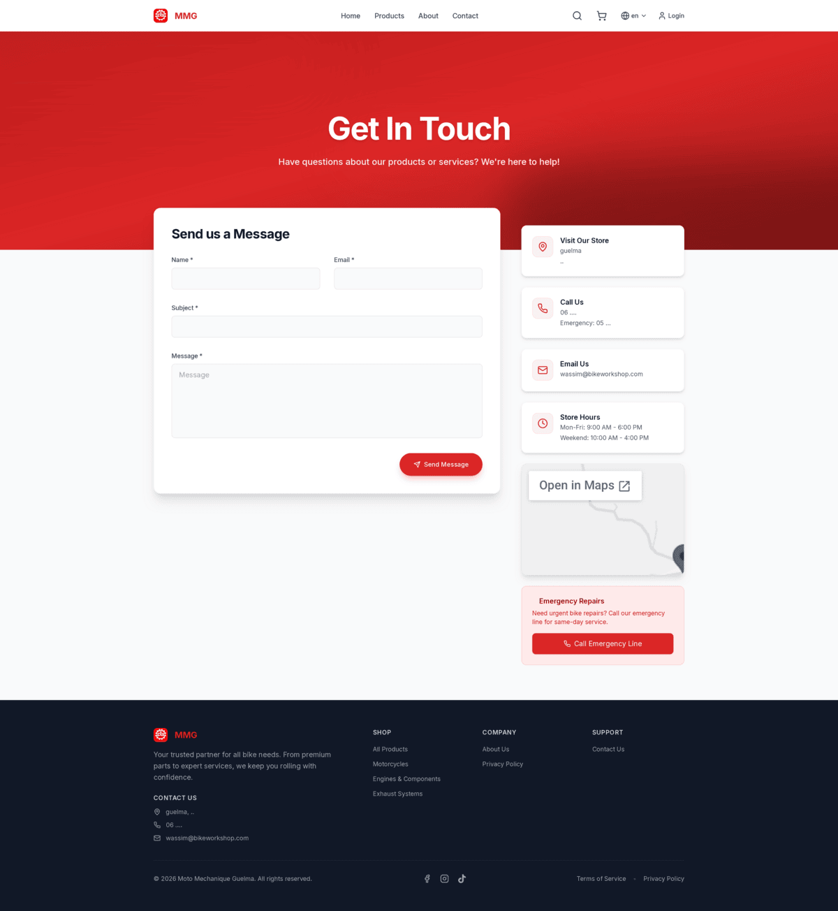</a> contact</td>
  </tr>
</table>

### Tablet and phone

<table>
  <tr>
    <td align="center" width="25%" valign="top"><a href="assets/main-page-fullpage-ipad-AR.png">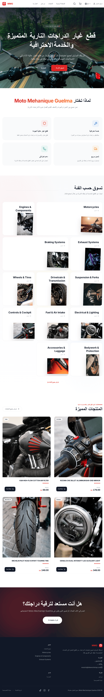</a> main page , tablet , بالعربية</td>
    <td align="center" width="25%" valign="top"><a href="assets/products-list-fullpage-ipad.png">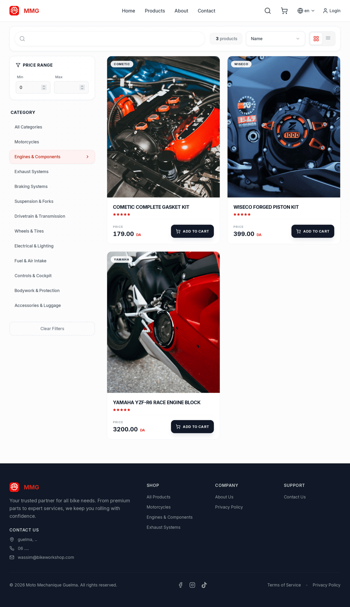</a> products list , tablet</td>
    <td align="center" width="25%" valign="top"> main page , phone</td>
    <td align="center" width="25%" valign="top"><a href="assets/product-page-fullpage-iphone.png">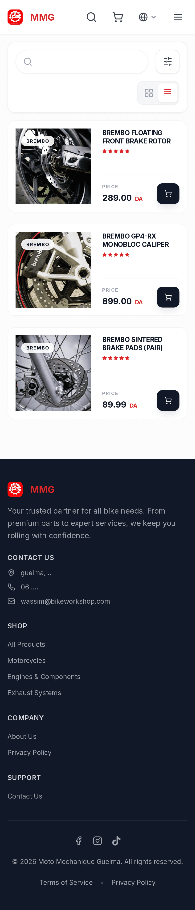</a> product page , phone</td>
  </tr>
</table>
