> this project is in production , a business owner asked for specific features , and has already used it and was contempt by it

## idea
my client asked for an app where he can control the rent of the apartments he has
  

he asked to be able to register a "reservation" for any specific house , for any client at a period of time

BUT he should be able to register reservations in two different methods , for a simpler explanation he said that:

1. he registers the __confirmed__ reservation with a __Pen__ . 
2. he registers the __non-confirmed__ "reservations" with a __Pencil__ , 
3. no two confirmed reservations overlap in house and time 
4. can register overlapping non-confirmed reservations 
5. clients can cancel at any given time
6. reservation is __per-night__
7. he shouldn't be able to register non-confirmed reservations that overlaps confirmed ones
8. if he registers a confirmed reservation at a period of time that overlaps non-confirmed one , he either cancels the non-confirmed ones and erase them , or maybe arrange another period of time n another house . (he calls the customers first)
9. he must have a chart or a way to see free/occupied until when
10. he should be able to register customers and their numbers and __notes__ on them , with an emphasis on the notes part

## Features
on top of what my client asked for

i added and tweaked (with him agreeing) , it became :

- he can register / cancel / extend or edit time period / switch houses for a customer
-  if tried to register a confirmed reservation at a period of time that overlaps non-confirmed one , the non-confirmed ones __will__ be cancelled __or__ dealt with one by one __or__ left to deal with them later -> his choice

-  a chart or a way to see [ free / occupied / occupied-and-confirmed / occupied by how many customers if there are more than one overlapping in time whether confirmed or not] and by whom (clicks to see the customer) at any given period of time , and per house   . 

- errands section -> he writes what he needs to do , with an importance meter
- he can [ register houses / edit them / soft-delete them /hard-delete them (a hard delete is only possible if no customer has reserved it before)  / edit the data of the house and adds pictures] -> he only asked for a fixed number of apartments , i made it dynamic as possible
- each house has a default price , but it is possible to alter it for any reservation at any given time
- pictures of each house are either share-able or not -> toggleable . and he can share pictures from withing the app into [telegram / snapchat / messenger ...and more] with one click to anyone he wants (usually to possible customers)
- also can share the location of the houses similarly
- knows which customer is coming / leaving today just when opening the app . and also see the due errands of today
- a customer can reserve more than a house in one booking and each house by a price and period (each house occupation is a `stay` ), and can switch house in the same booking if asked for and not-occupied
- discount per stay
- a nice UI and settings
- multi language : Arabic / French /English
- a page for bookings by [ time / customer / house / confirmed-cancelled-on_hold / order] for any given period of time 

- an __EXTENSIVE__  statistics page , including :

	- at any given period of time . grouped by houses (one or the ones chosen) . grouped by [day / week / month / semester /year] . counted when [booked / stayed]  `--APPLIES TO ALL THE NEXT`
	- by charts and numbers (can hide the detailed numbered which are grouped by [day / week /....])   `--APPLIES TO ALL THE NEXT`
	
	- statistics of Bookings  : shows
		
		- nbr of bookings  
		- nbr of stays 
		- nights sold number
		- average nights booked per booking number
		- cancellation rate
		- avg booked-ahead by days number
		- occupancy rate for the chosen period 
		- stays over time __Chart__ (confirmed / on-hold / cancelled)  . AND the numbers are hidden and could be extended if wants to see them 
		- and by house __BAR-chart__ for how much money made , with nights count in that period of time . . also the numbers are hidden and could be extended if wants to see them 
		
	- statistics of __Money__: shows
		-  nights priced total number of the chosen period ; number
		- total money income ; number
		- total money owed (still to be paid) number . 
		- number of bookings owing (have not paid yet)
		- total discounts given money
		- a __Line-chart__ through out the period of : 
			- money income
			- discounts given
			- owed money
			- -> with the numbers section for the details , which is extensible
		- a chart  of two bars showing the difference between income before discount  and  after discount (which is showing the at-door-negotiation difference making)
		
	- statistics of __Guests__ (customers) :
		- total number of customers
		- added number of customers this period
		- rate of bookings per-returning customers in the chosen period
		%%- a __Bar chart__ showing the number of new and returning customers in that period (grouped by the filter mentioned at the top)%%
		
	- statistics of errands :
		- nbr of errands in the chosen period
		- nbr of errands still open
		- nbr of errands done
		- a __line chart__ showing both : errands created , and errands done by the time created/done 
		- a numbers extensible section for details of this chart
 
- and More features

 

---

 

## Performance and Optimization

the app database have been populated with more than 10 years of data (more than the actual client would fill even if he uses the app for 30 years)

tested thoroughly

all the screen get the data from the DB with optimized queries ; i mean there is no query that gets the full table or so then show just the required data , as that is a waste of resources 

but actually get the required data only

The app screens were tested using **custom SQL query logging and timing via** `**SqlLogInterceptor**`, with the slowest query taking less than 50 ms (33ms to be exact).

 — captured with

`script --flush --command "flutter run -d linux --profile --dart-define=LOG_SQL=true" ~/sql-run.log`.

**The app is clean.** A whole browsing session was **161 queries / ~1.5 s of database time**;

nothing repeated more than 7 times (no N+1 anywhere); **no unbounded read at all** except

`SELECT * FROM houses`, which is the sanctioned exception (intended to be this way); 

slowest single statement 33 ms. 

> The performance pass is measured rather than merely asserted.

 

---
 

## Some pictures of the app 

 

#### main screen

  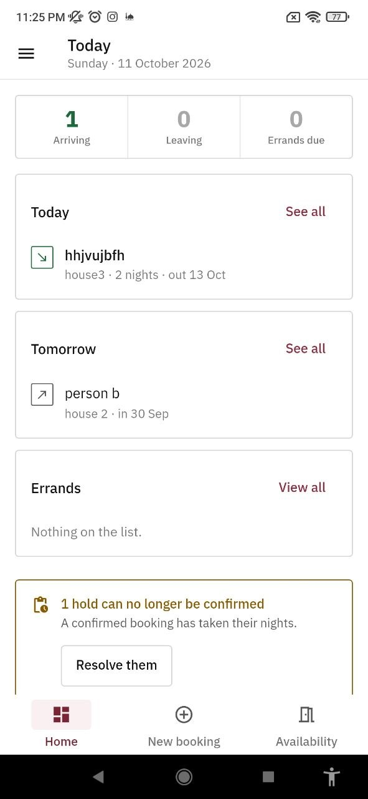
  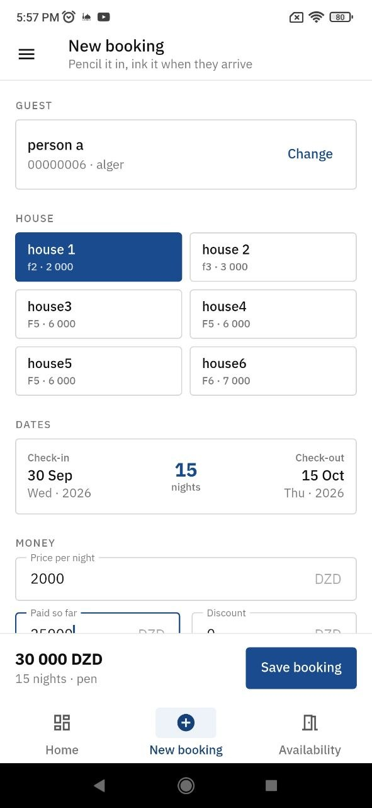
  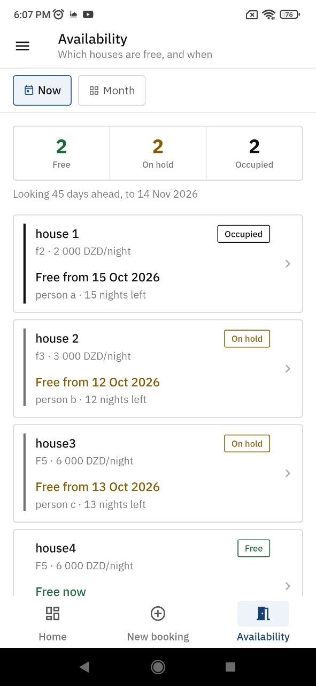
   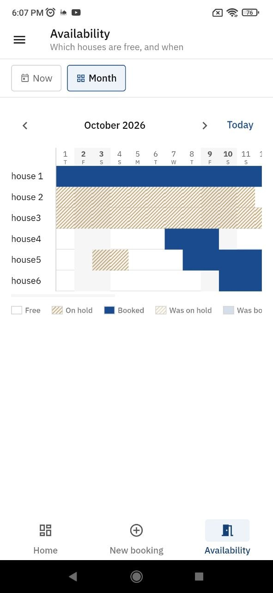
  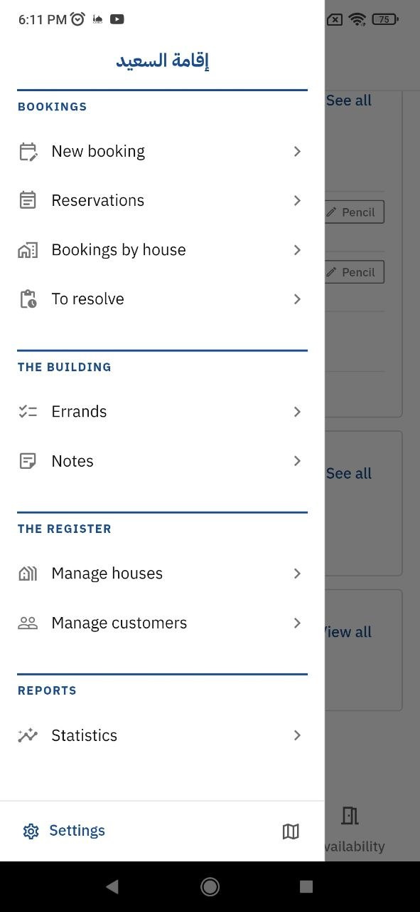

  <!-- Repeat for all 20+ images -->

 

#### some of the other screens

  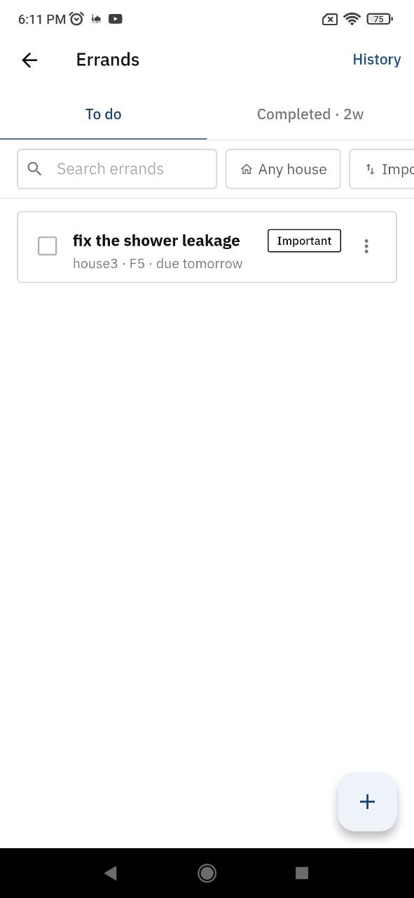
  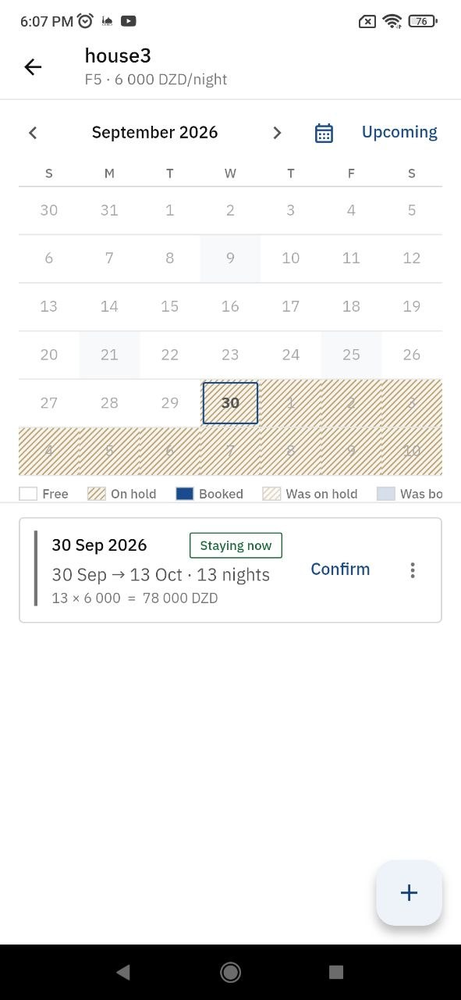
  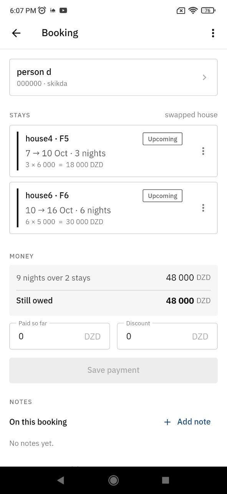
   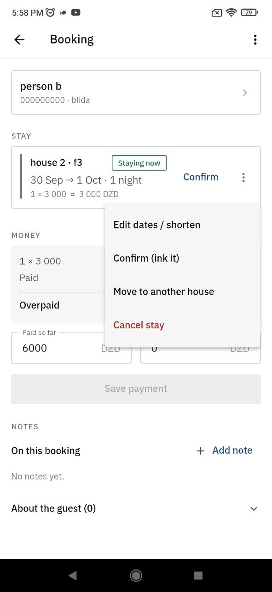
  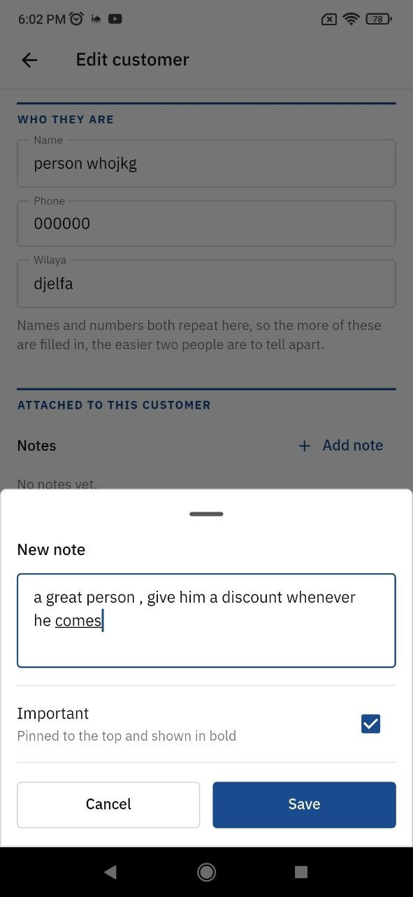
  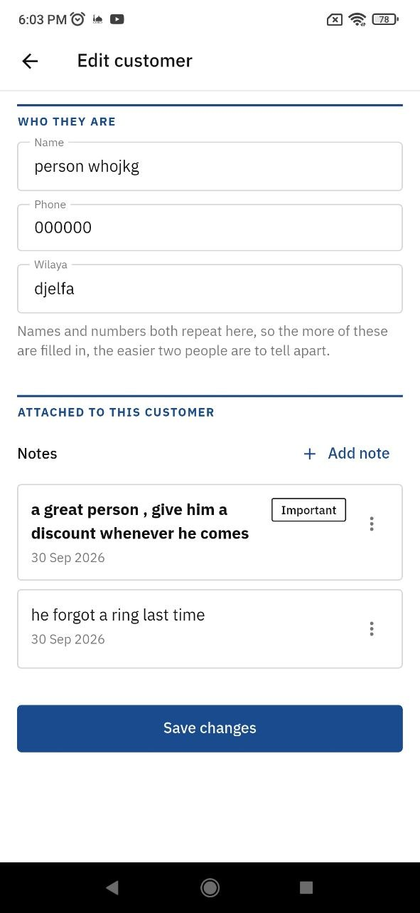
  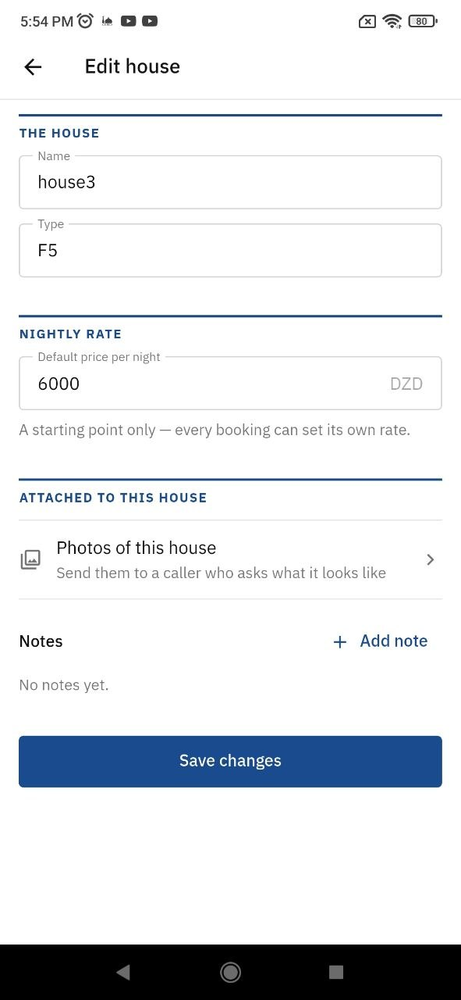  
  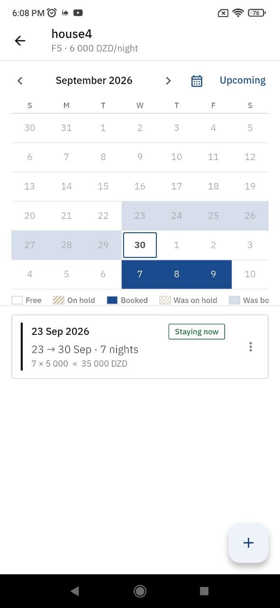

  <!-- Repeat for all 20+ images -->

 

#### Statistics

  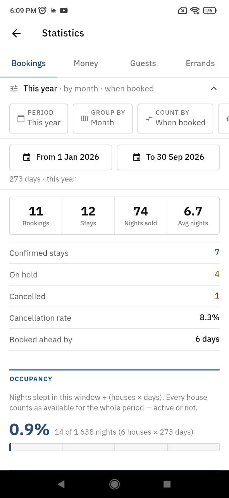
  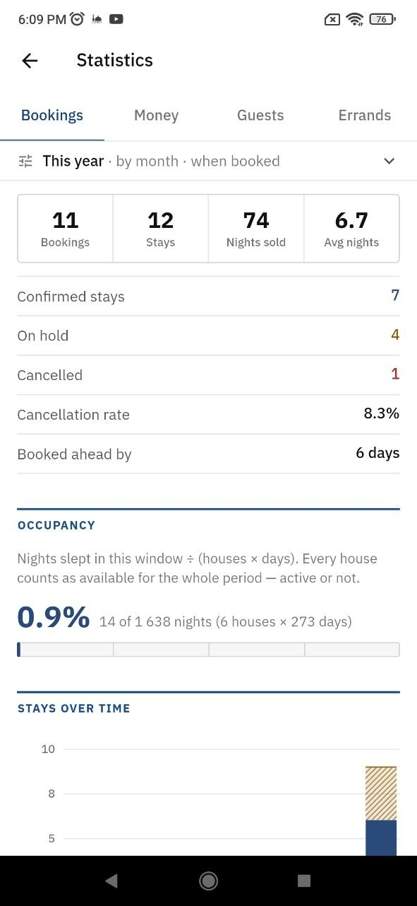
  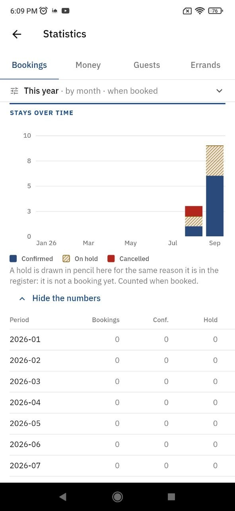
  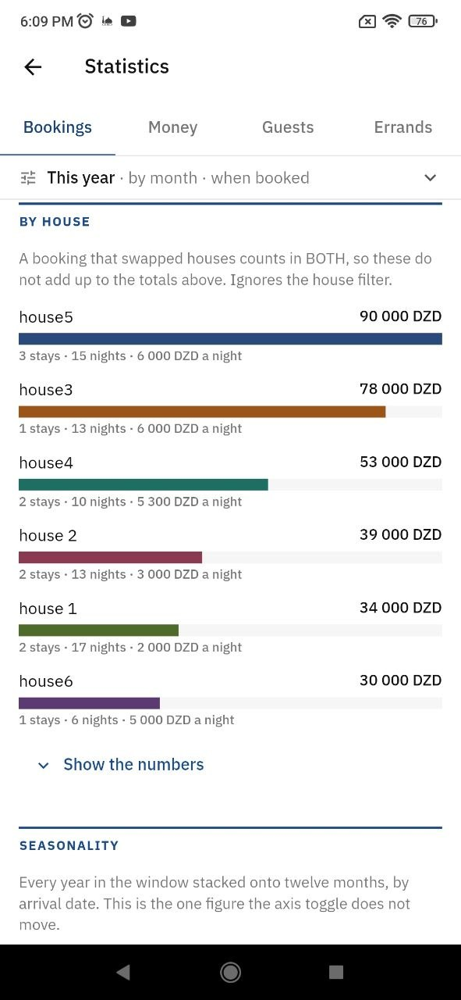
  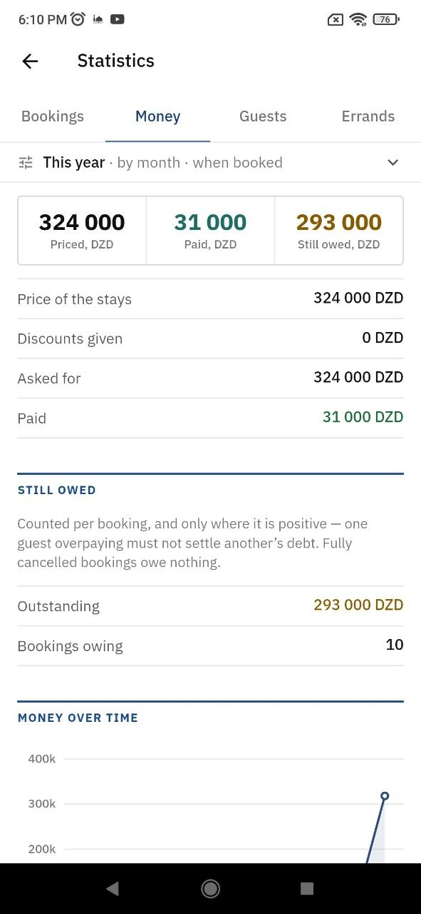
  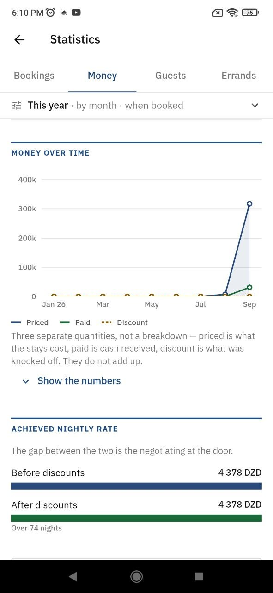
 
    
  
  <!-- Repeat for all 20+ images -->

 

#### settings 

  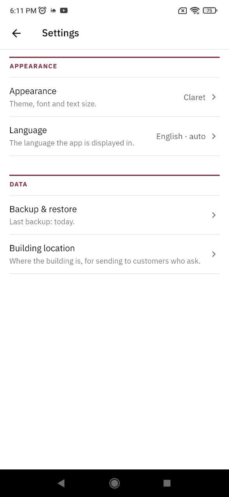
  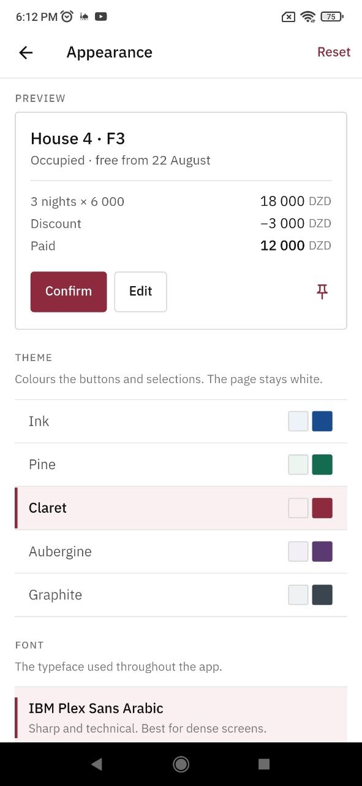
  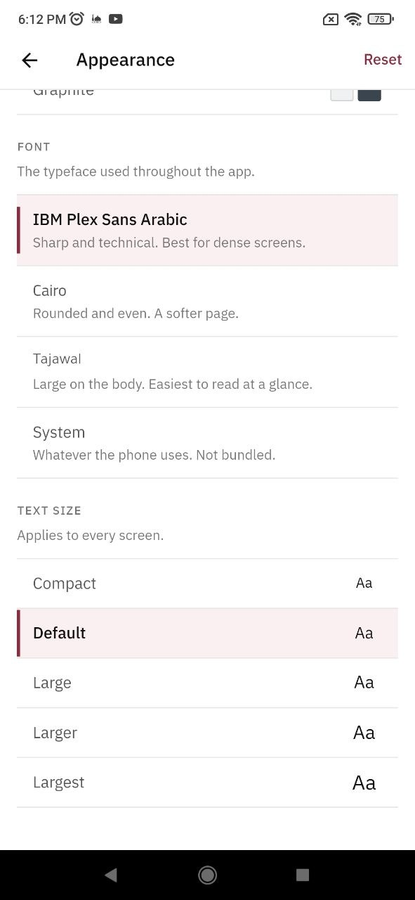

  <!-- Repeat for all 20+ images -->

