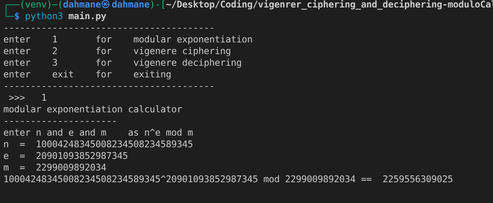
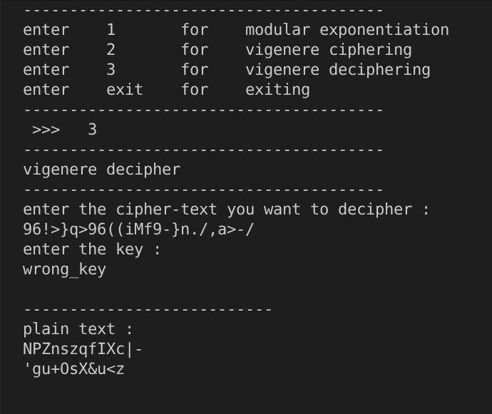

this is a simple project showing the _Foundation_ of big numbers exponentiation modulo calculation approach using the `fermats-little theorem` ,
and some vigenere ciphering and deciphering 


## modulo calc

### introduction

if you try this in python
```py
x = 10004248345008234508234589345 ** 20901093852987345
print(x % 2299009892034)
```
you will not get the result , instead 
your pc will starts to breath like it reached enlightenment and discovered the water breathing technique from kimetsu
you won't get the result still

__why though ?__

Here, the base has 29 digits and the exponent is about 
$$
2.09\times10^{16}
$$
The resulting integer would have approximately
$$
29 \times 2.09 \times 10^{16} \approx 6.06 \times 10^{17}
$$
decimal digits.

That is roughly __606 quadrillion digits!!__

To store that result as a normal binary integer would require approximately __250 petabytes of memory__. Your PC doesn't have that kind of RAM.

---
### result



## Vigenere ciphering and deciphering

just an implementation of the vigenere cipher/decipher from scratch
and it uses the exponentiation method from earlier

#### Ciphering
enter the text and a KEY , (remember the key)
and you get the result


#### Deciphering

enter the ciphered text and the CORRECT KEY to get the result


but if you put the wrong key :



___
