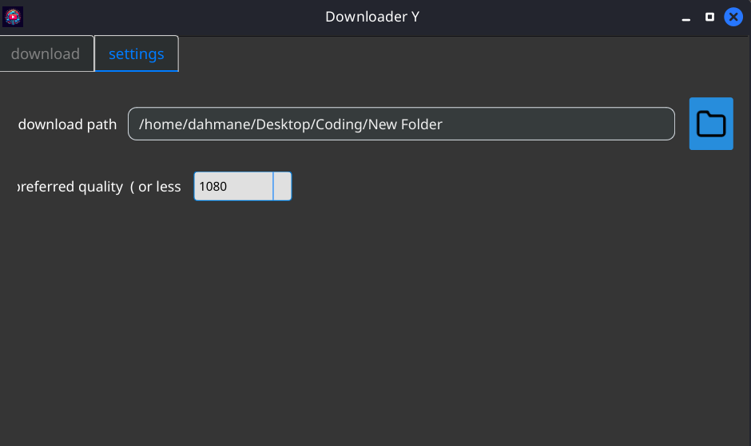
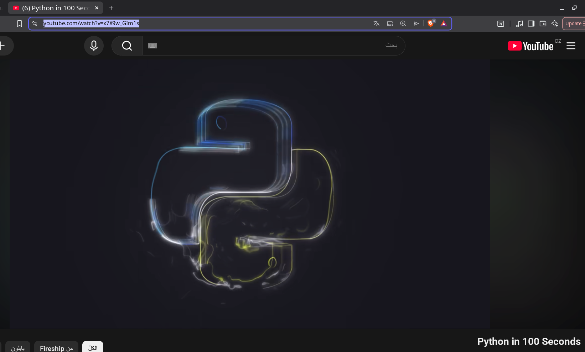
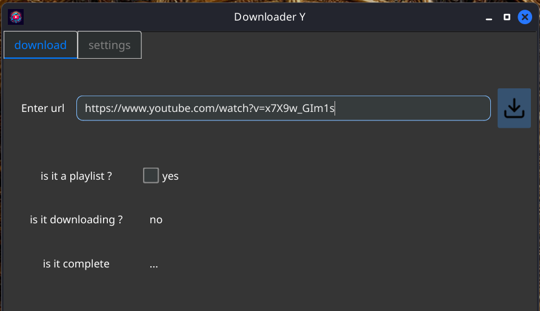
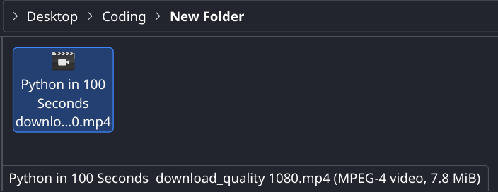

## Idea
i needed an app to download videos in high quality from Youtube to watch them in university dorm where i had a limited amount of internet connection , so i can watch in my free time if the internet runs out or i lose connection for any reason (which happened a lot)

there were no free alternatives , all the websites and apps i found were either paid or offer a lower resolution download for the fee tier

SO
i made this desktop app to solve that issue , and it worked super fine through those times

## what the app does
downloads Youtube videos or even entire playlists
you paste a link of a video (or a playlist) , it get the thumbnail and metadata
you choose which video quality you want or default (you can save a default) : [144px ... 4320px] or just audio if you want 
the you download it to a specific location on your machine or a default location (you can specify a default location)

## Stack
`python` 
`pyside6` - framework
`yt_dlp` - library

## important detail
it probably wont work if you download it as the project is kinda old so the `yt_dlp` library probably has changed since
but with just few perks it will work fine

# some pictures and how to use
first of all after installing it, choose 
the location folder
and
a preferred quality

then , get the video you want to watch from youtube , copy its link 

then paste it in the app then click download

and you will find the result in the specified location
